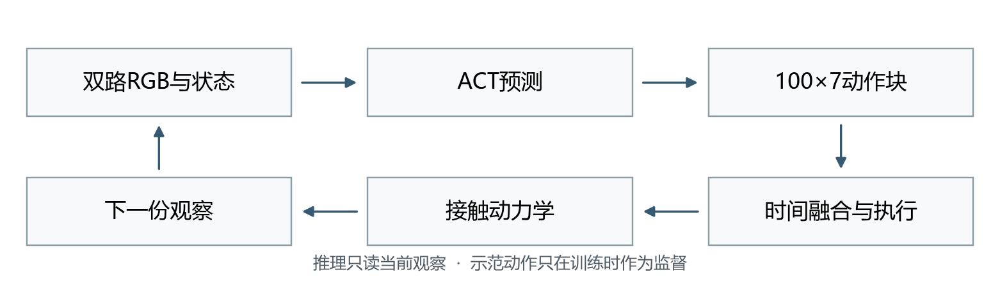
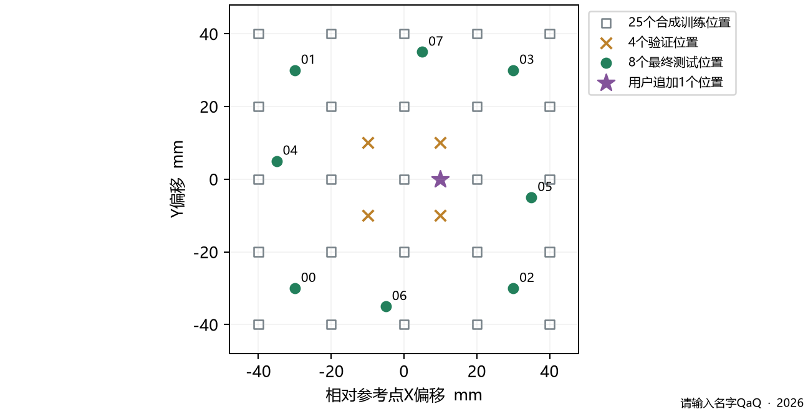
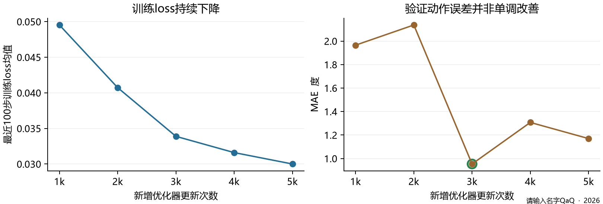

# ACT 抓放仿真训练复现与调参复盘

作者：请输入名字QaQ  ·  GitHub：1595530254a-afk  ·  2026年10月24日

这个项目想做的事很直接：把B601公开ACT模型接进MuJoCo，先跑通红块入灰盒，再考虑自己的机械臂。真正做起来，却先后遇到抓不起来、靠近后不闭爪、原位成功但挪位失败。这里按实际经过，讲我们查了什么、为什么改，以及哪些尝试没有带来预期结果。

任务看起来相似，画面和动作的对应关系却未必相同。我们先让夹爪在物理仿真里抓住红块，再查执行循环、补位置示范，最后把训练指标和完整抓放放在一起看。

最后选用的是连续5000步实验中的 **step3000＋ensemble1**：原位1/1、四个验证位置4/4；选定后再测预先保留的八个位置，得到8/8。后来又临时加了一点，单次成功1/1。这些成绩和后面的失败记录一起，构成了这次复盘的依据。



图中的循环贯穿后面的排错：ACT接收两路RGB和七维关节状态，预测未来100行七维动作；执行后，运动和接触又改变下一帧画面。示范动作只在训练时充当答案，推理时由模型自己预测。它没有单独输出“红块识别成功”的检测结果，我们因此要把画面、预测和实际接触一起看。

前两节先讲排错经过，再展开数据、损失和参数。episode是一次完整示范，batch是一次更新选取的观察起点数，training step是一次参数更新；30 Hz则是动作频率。

资料入口：[ACT原作者项目](https://github.com/tonyzhaozh/act)；[LeRobot ACT说明](https://huggingface.co/docs/lerobot/act)。

## 1  从公开权重到第一轮失败

### 先让仿真里的抓取成立

我们下载公开的B601真实演示和ACT权重，在本机用这份数据续训1000步，再接入重建的仿真，希望借助已有模型减少从头采集和训练的工作。

但第一轮只是在显示关节姿态与预测轨迹，红块并没有被夹起来。qpos回放适合检查角度和姿态，真正抓取还要靠手指与物体的接触。于是我们补上接触动力学、关节跟踪和任务评分，开始检查物体是否被抬起、是否入盒、最后是否放稳。

加上物理之后，公开原始权重和真实数据续训1000步的权重，在原位仍没有完成抓放。我们先把注意力放回仿真本身：相机看到的内容、关节角度的含义、夹爪开度和接触条件，是否真的与来源数据对得上？直接继续训练，暂时回答不了这些问题。

我们先固定道具尺寸和两路相机，再核对公开关节角度、夹爪开度与仿真坐标。从公开episode 0的实测状态出发，生成403帧物理教师，并调整放置时的松爪目标。这一次教师完成了抓取和入盒，我们才有了把握：至少在这套场景与控制器里，任务本身做得成。接下来要解决的是让ACT学会做。

有了这条成功示范，我们在真实数据续训1000步的权重上再训练300步，记作sim300。batch为2、学习率1e-5，参数为FP32，前向使用BF16 autocast。这300步学习的，是当前仿真里的画面、状态与动作怎样对应。

### 靠近以后为什么没有闭爪

适配之后，机械臂会靠近目标，却迟迟不闭爪。我们没有立刻再加训练，而是翻出模型预测的整段动作：闭爪其实在动作块较后的位置。问题是，当时只执行前10步就重新计算，后面的闭爪动作一次次被丢掉了。

同一模型、同一场景，恢复为100步执行后，原位抓放成功，红块抬升约94.69 mm。这次有清楚的前后对照：模型已经给出了后续动作，是执行循环没让它走到那里。

这件事让我们后来排错时多问了一句：是模型没有预测，还是预测了却没执行到？不过，100步解决的是当时那份单点策略的问题，不能由此推成所有ACT都应该一次执行100步。

## 2  从单点成功到位置泛化

### 方块换了位置之后

原位能抓住了，下一步自然是把方块挪一挪。我们固定sim300和其他条件，只换方块的XY位置，五点结果是0/5。这里的单条示范，指最后新增的仿真示范；模型之前还学过公开真实数据。已有经验迁到这个重建场景后，仍然只在局部位置上奏效。

检查首份预测时，相同初始关节状态配上不同位置的图像，输出确实变了，只是还没有变成有效抓放。后来把公开权重、真实续训1000步和sim300放进同一套六位置流程，前两者原位及其余五点均失败，sim300只有原位成功。这更支持“迁移只在局部成立”的判断，而不是直接认定最后300步把原来的能力忘掉了。

接下来的目标因此很具体：给模型更多位置上正确的抓放示范，并留出完整位置回合，看看它能否调整路径，而不只是重复熟悉的一条。

### 增加示范后仍然没有立即成功

我们把教师扩成25个训练位置和4个验证位置，随后试了延长适配、整理数据和补恢复示范。几条分支的结果放在一起看，更容易看清哪些改动没有带来预期改善；它们各自训练，更新次数分开计算。

| 尝试 | 采取的改动 | 实际抓放结果 |
| --- | --- | --- |
| 多位置v1 | sim300上新增600步，batch2、lr3e-6 | 原位通过，验证2/4；当轮提前保留六点0/6 |
| 多位置v2 | 在v1上再训练1200步 | 中间600验证2/4但原位失败；末期验证0/4 |
| clean v3 | 从v1另开2400步分支 | 所选step1800验证0/4 |
| recovery | 从v1另开2400步，lr1e-6，补22条恢复专家 | 所选模型验证仍0/4 |

v1一度把四位置验证改善到2/4，但在当轮提前保留的六点仍是0/6。这里与前面的0/5是两组位置：那五个旧诊断点，v1后来得到1/5。我们把两组分开记，避免只挑成功的一点来说明进步。

更值得注意的是v2：离线动作MAE已经降到约1.535度，四位置抓放却退回0/4。对照轨迹时，合拢阶段出现约18～20 mm的Y方向残差，空夹后下一段又要求张爪。这是与教师对应阶段的路径差，尚不能直接当作视觉定位误差，但它指出了实际失败发生在哪里。

我们的理解也随之改变：在教师给定的状态上答得更准，未必能处理自己执行后出现的新状态。我们又补了22条成功恢复专家，所评估模型仍是0/4。这些尝试至少提醒我们，继续降离线误差，或给专家多做一些成功动作，都还没有解决学生的闭环问题。

### 重新组织一轮训练和验证

这时我们没有继续接着失败分支往下训，而是回到sim300，重新做一条连续5000步实验：batch改为8、学习率改为1e-5，每1000步保留模型。每份候选都放回同一套原位和四位置流程，同时比较chunk100与逐帧重算、融合重叠预测的ensemble1。这样，选的既是权重，也是它实际怎样执行。

这轮有两份候选完成了四点验证：step2000和step3000搭配ensemble1都为4/4。我们按提前写好的规则选择验证误差更低的step3000，之后才检查八个保留位置。选模过程和最终结果见第6、8节。

这轮同时调整了训练预算、batch、学习率和反馈方式，没有做完整的逐项消融。结果说明这套组合在当前任务中有效，还不能把功劳单独归给某一个参数。最终权重的来源是公开权重→真实续训1000→sim300→新分支step3000，累计仿真适配3300步；这一分支加载权重后重新建立优化器状态。

## 3  把任务变成对应正确的训练数据

前面多次提到“补示范”，这里把它摊开讲。真正要补的不是更多红块图片，而是在不同位置看到这样的画面时，机械臂应该怎样接近、闭爪、抬起和放下。

平顶红块定为40×40×20 mm，灰盒外尺寸120×120×50 mm，壁和底各4 mm，两路相机也固定。这是本项目选定的尺寸，并非来源实物的测量值。之后不再随结果改大小，省得把任务变容易误当成算法进步。

403帧、30 Hz的物理教师，用公开episode 0的实测state转换成目标动作，再为40 mm红块调整放置松爪，并未直接照搬原action列。

随后用六关节Jacobian IK，把这条路径的接近、抓取和抬升部分移到25个位置，运输阶段再平滑接回同一放置路径。这样每个位置都有对应的动作答案。夹爪时序仍沿用源示范，所以这些是25条合成位置变体，不是25次独立人工操作。

| 数据划分 | 位置与数量 | 用途 |
| --- | --- | --- |
| 训练 | X/Y各取−40、−20、0、20、40 mm，共25回合、10,075帧 | 更新参数 |
| 验证 | X/Y各取±10 mm，共4回合、1,612帧 | 选模型和执行模式 |
| 最终测试 | 另保留8个新位置，每点一次 | 冻结选择后检查局部泛化 |



一个位置的完整回合放在同一组，避免相邻帧混入训练和验证。另一个容易漏掉的细节是时间对应：图像用动作前qpos渲染，state和教师action也取同一时刻。画面晚一拍、动作早一拍，学到的对应就会错位。

实现：[教师生成](https://github.com/1595530254a-afk/act/blob/ad5ac9f685ca7f7d28e8266d6d040fadf89ab41c/simulation/generate_multisite_teacher.py#L94-L133)；[动作前画面导出](https://github.com/1595530254a-afk/act/blob/ad5ac9f685ca7f7d28e8266d6d040fadf89ab41c/simulation/export_multisite_rgb.py)；[完整位置隔离](https://github.com/1595530254a-afk/act/blob/ad5ac9f685ca7f7d28e8266d6d040fadf89ab41c/simulation/adapt_act_multisite_20261024.py#L128-L162)。

## 4  一次训练更新到底学了什么

一次更新拿什么来学？从10,075个训练帧起点中随机取8个不同起点，读取当前观察与后续动作答案。跨更新允许重复，标签不跨episode。一个batch的状态为[8,7]，两路RGB各为[8,3,480,640]，动作标签为[8,100,7]。

回合尾部凑不满100行动作时，复制最后一行补齐，并用action_is_pad标记；计算L1时，分子和分母都排除这些补齐行。例如403帧回合的最后一帧只有1行有效答案，其余99行只是为了把张量形状补齐。

### 实际使用的损失

总损失 = 标准化动作的L1误差 + 10 × KL正则项。

L1衡量100行预测动作与示范动作的差距，按有效动作行数×7个通道取平均。KL约束32维潜变量分布，先对32维求和，再对batch平均；它帮助训练中的条件变分编码器学习示范变化。KL系数10本轮保持不变，没有围绕它做搜索。

训练时，编码器会读取示范动作来估计潜变量分布；推理时拿不到这份答案，使用零潜变量。这也是后面把训练loss和验证MAE分别画出的原因：两者看的不是同一件事，数值大小不能直接相比。

拿step3000当步举例：L1约0.0319235，KL约0.000051342，总loss因此约为0.0324369。这里的L1已经标准化，**0.03不是0.03度，也不是3%的抓取失败率**。AdamW另做解耦参数衰减，weight decay没有再加进CSV里的loss。

### 更新顺序

1. 读取batch并使用来源模型保存的处理器做归一化。
2. 调用policy.train()，清空上一批梯度，再执行前向和loss计算。
3. loss.backward()求出参数梯度；将全局梯度范数裁剪到上限10。
4. optimizer.step()由AdamW更新参数，完成一个training step。

验证时会切到eval状态，下一次反向传播前再恢复训练模式。来源模型的处理器和统计文件则一直保留，不随checkpoint重新拟合，保证训练与推理使用同一套归一化。

实现：[组batch](https://github.com/1595530254a-afk/act/blob/ad5ac9f685ca7f7d28e8266d6d040fadf89ab41c/simulation/adapt_act_multisite_20261024.py#L109-L125)；[反向传播与裁剪](https://github.com/1595530254a-afk/act/blob/ad5ac9f685ca7f7d28e8266d6d040fadf89ab41c/simulation/adapt_act_sim.py#L232-L253)。loss公式按本地安装LeRobot 0.6.1的ACT实现核对，版本源码见文末索引。

## 5  实际训练参数与计算资源

参数要核对优化器实际用了什么。config.json里的optimizer_lr与optimizer_lr_backbone均为1e-6，但这次脚本重新建立AdamW参数组，所有可训练参数统一使用1e-5。下表记录实际运行值。

| 参数 | 实际设置 | 对训练的含义 |
| --- | --- | --- |
| batch size | 8，全程未降档 | 每次更新取8个观察起点；不是8条完整回合 |
| 学习率 | 1e-5，恒定 | 控制参数更新尺度；没有启用warmup或调度 |
| 优化器 | AdamW | betas为0.9/0.999，eps为1e-8 |
| weight decay | 1e-4 | 参数衰减；本轮保持不变 |
| KL系数 | 10 | VAE正则权重；本轮保持不变 |
| 梯度裁剪 | 全局范数上限10 | 限制异常大梯度；不是学习率，也不是机械力矩限制 |
| 训练精度 | FP32 | 正式长训未使用BF16、AMP或梯度累积 |
| 动作块长度 | 100 | 预测当前起连续100个动作槽，标签间隔为1帧 |
| 检查点间隔 | 1000次更新 | 保留1k至5k，留给验证选择 |
| 随机种子 | 20261024 | 固定采样和训练随机数，包括潜变量采样与dropout |

我们沿用原网络结构，dropout为0.1、潜变量32维。ResNet18中可训练的卷积参数与Transformer一起更新，学习率相同；名字里的FrozenBatchNorm2d只说明这类归一化层的处理，并不表示整个视觉骨干被冻结。

### 区分四种常被混写的步长

训练5000 steps，就是做5000次参数更新。batch为8，合计抽取40,000个观察窗口，其中可以重复、也可以重叠，原始示范仍只有那25个训练回合。脚本采用随机抽样，没有严格逐回合遍历的epoch。

再看机械臂这边：数据与动作频率为30 Hz，一帧约33.33 ms，100个动作槽约覆盖3.33秒。MuJoCo内部还以1 ms物理子步推进，每个动作槽约33或34个子步。这些子步用于计算运动和接触，ACT的查询频率则由第7节的执行模式决定。

实现：[实际优化器配置](https://github.com/1595530254a-afk/act/blob/ad5ac9f685ca7f7d28e8266d6d040fadf89ab41c/simulation/adapt_act_multisite_20261024.py#L228-L249)；[FP32更新循环](https://github.com/1595530254a-afk/act/blob/ad5ac9f685ca7f7d28e8266d6d040fadf89ab41c/simulation/adapt_act_multisite_20261024.py#L295-L318)。

## 6  为什么5000步里选的是3000步

这条新分支完整跑了5000次更新，全程batch 8，没有出现OOM。训练循环连同验证和保存约用1201.8秒，峰值CUDA allocated约3766.5 MiB，本机显存为8 GB。约20分钟说的是已有权重、已有缓存下的这次适配，不是从零训练ACT所需的时间。



| 新增更新步数 | 最近100步训练loss均值 | 验证MAE 标准化 | 验证MAE 度 |
| --- | --- | --- | --- |
| 1000 | 0.049529 | 0.070125 | 1.965 |
| 2000 | 0.040725 | 0.079688 | 2.137 |
| 3000 | 0.033885 | 0.035402 | 0.953 |
| 4000 | 0.031602 | 0.048672 | 1.307 |
| 5000 | 0.030000 | 0.044748 | 1.170 |

如果只盯着训练loss，看到5000步会觉得还在进步。但验证误差在3000步以后又升了起来。表中训练值是最近100步的均值，说明模型对训练样本拟合得更好了；它没有告诉我们新位置是否更好抓。这正是保留中间模型的用处。

离线验证时，我们在每个完整验证回合取0、100、201、301、402五个观察锚点，让模型预测，再与后续动作比较。每回合有401行有效目标，排除padding后计算误差，最后对4回合等权平均。这个数帮助筛选候选，候选接下来还要在仿真中真正做完抓放。

### 选模型的顺序

我们提前定下了选择顺序：先看同执行模式的原位能否成功，再比4个验证位置的完整抓放数，其次比稳态抓持数，仍相同才看标准化MAE。step2000和step3000搭配ensemble1都是4/4，step3000的误差更低，因此被选中。

另一边，step5000因为夹爪目标越界，被保护检查中断。我们保留这个结果，没有裁剪输出或放宽界限让它继续。最后留下step3000与ensemble1，固定这份选择，再去测试八个保留位置。

## 7  训练完成之后怎样执行动作

单点时那次“不闭爪”已经提醒过我们，权重只是策略的一部分。一个动作块预测出来以后，执行多少步、什么时候重新看图、怎样融合前后预测，都可能改变最后结果。这次我们把两种执行方式放在一起比较。

| 模式 | 15秒仿真中的真实ACT查询 | 执行方式 |
| --- | --- | --- |
| chunk100 | 5次 | 一次预测后顺序执行100个动作，再看图重算 |
| ensemble1 | 450次 | 每个动作槽重新取双RGB和state，预测后做时间集成 |

ensemble1每帧都会重新预测，再把覆盖当前时刻的多份预测加权。它沿用旧预测在前的exp(−0.01×序号)规则；满100份重叠预测时，最新一份权重约0.585%，来源平均年龄约57.70帧。因此动作更平滑，同时也带着旧预测的滞后，并非每次直接执行最新预测的第一行。

| 模型 | chunk100 原位／4验证 | ensemble1 原位／4验证 |
| --- | --- | --- |
| 旧保留step600 | 通过／2/4 | 通过／1/4 |
| 新1000 | 通过／2/4 | 失败／0/4 |
| 新2000 | 越界／未运行 | 通过／4/4 |
| 新3000 | 通过／验证途中越界 | 通过／4/4，选定 |
| 新4000 | 越界／未运行 | 通过／3/4 |
| 新5000 | 越界／未运行 | 越界／未运行 |

表里也能看到，逐帧反馈并不是换上就好：旧step600从2/4变成1/4，新step1000也没有改善。它与训练得更充分的step2000、step3000组合后，才得到4/4。与此前每10步丢掉整个后半段不同，ensemble1会保留重叠预测；两种做法都重新看图，实际使用动作的方式却不一样。

实现：[新观察闭环](https://github.com/1595530254a-afk/act/blob/ad5ac9f685ca7f7d28e8266d6d040fadf89ab41c/simulation/evaluate_feedback_20261024.py#L121-L237)；[时间集成](https://github.com/1595530254a-afk/act/blob/ad5ac9f685ca7f7d28e8266d6d040fadf89ab41c/simulation/evaluate_act_ensemble.py#L29-L64)。

## 8  最后验证了什么能力

确定模型与执行方式之后，我们才打开预先保留的八个位置，每点只试一次，也没有看完结果再回头选模型。下表的XY偏移都相对参考抓取点；其他场景条件保持原样。

| 测试点 | X与Y偏移 mm | 最大抬升 mm | 完整入盒 |
| --- | --- | --- | --- |
| 00 | -30，-30 | 99.62 | 成功 |
| 01 | -30，+30 | 104.71 | 成功 |
| 02 | +30，-30 | 96.78 | 成功 |
| 03 | +30，+30 | 102.87 | 成功 |
| 04 | -35，+5 | 105.94 | 成功 |
| 05 | +35，-5 | 97.54 | 成功 |
| 06 | -5，-35 | 97.18 | 成功 |
| 07 | +5，+35 | 102.30 | 成功 |

八点都完成了入盒，最大抬升96.78至105.94 mm，抬高时双指连续接触维持68至73帧。之后又临时追加(+10,0) mm位置，用同一模型与模式单次测试，结果为1/1。这个点是在看过八点结果后追加的，因此另外记录。

### 成功不是只看动画

我们按几条具体条件判断抓放：红块抬升至少30 mm，八个角点的XY投影都进入盒内，最后落稳盒底、速度小于0.05 m/s，且手指已经离开。抬高时还要有至少3帧双指持续接触，确认它确实被夹起，而不是碰巧推了进去。

还有一个需要回答的问题：它是否只是重放了教师轨迹？我们用保存的观察重新调用冻结ACT，八点共3600个动作块、252万个动作值与原记录逐值一致，追加点也另行复算。相同初态下改变红块位置，首份预测随之变化。连同接触与运动记录，这些检查把“动作由ACT预测”和“物体实际被抓放”两件事都对上了。

### 这些指标能说明到哪一步

这次走到的是固定仿真场景内的局部XY位置适应：八点都在训练网格范围内，每点只试一次。换物体、变高度、移动相机、改变光照，以及真实接触都还没测；原始50条真实演示是否覆盖过附近位置也未知。因此8/8是这八次测试的结果，不是任意场景的成功率。

还有速度上的区别：30 Hz是仿真控制时间，推理时仿真可以等电脑。笔记本能否跟上真实机械臂，还要把采图、传输、推理和控制的墙钟延迟一起测出来。

## 9  怎样开始自己的复现实验

想沿这条路线复现，先进入仓库的 **ACT仿真** 目录。ACT环境使用Python3.12、Torch2.10.0+cu130、LeRobot0.6.1，MuJoCo环境使用3.17.0；各自目录保留了锁定依赖和官方资产清单。

先备齐sim300六文件初始化、25训练＋4验证回合的轨迹、manifest和58个RGB数组。仅RGB约20.06 GiB，用memmap按需读取；缓存和206.7 MB权重都在源码之外。重现这条5000步实验，应从sim300开始。

材料路线是：公开源数据→403帧物理教师→单点sim300适配；教师另扩为25位置→按动作前状态导出双RGB→多位置训练。历史sim300接续了真实续训1000步的权重，复现时要保留这一起点；直接从公开权重开始则另记为新实验。详细命令见仓库“训练复现步骤”。

### 先检查数据再开始训练

按仓库复现指南设置两个变量：$Manifest指向25训练与4验证回合的manifest，$SourceModel指向完整sim300初始化目录。确认路径对应后，先运行数据检查：

```powershell
.\.venv\Scripts\python.exe simulation\adapt_act_multisite_20261024.py `
  --data-manifest $Manifest --batch-size 8 --check-data
```

检查会核对回合、张量形状、边界与padding，不加载模型、不更新参数。通过之后，选择新的输出目录再训练：

```powershell
.\.venv\Scripts\python.exe simulation\adapt_act_multisite_20261024.py `
  --data-manifest $Manifest --model-dir $SourceModel `
  --output-dir runs\reproduce_long5000_v1 `
  --steps 5000 --batch-size 8 --learning-rate 1e-5 `
  --save-every 1000 --validation-anchors 5 --seed 20261024 `
  --prior-adaptation-steps 300
```

训练后看training_metrics.csv，模型保存在checkpoints/step_001000至step_005000/pretrained_model。prior-adaptation-steps只记录来源累计步数；这里保存的是权重和处理器，没有完整优化器及随机状态，后续加载会重新建立AdamW。

接下来逐候选运行原位与4个验证位置，按第6节规则选“模型＋模式”，选定以后再试新的位置。这样才能知道自己复现的是动作拟合，还是完整的抓放。

## 10  剩余问题与后续验证顺序

现在我们已经越过了“原位抓不起来”这道坎，但还需要知道这份能力能保持多久、换些条件以后还能留下多少。下一轮先保住能工作的版本，再有顺序地扩大变化，比立刻把所有东西都改掉更容易找到问题。

先保留step3000、完整六文件处理器、时间融合系数、双相机命名和当前场景，后续改动都与它比较。继续检查原位与四位置验证，也在新的测试位置上观察初态偏差带来的影响。失败要具体记到阶段：接近没对准、闭爪没夹住、抬升脱落，还是放置碰盒；知道失在哪一步，才知道该补什么示范。

接着再逐步加入相机高度、视角、背景和光照变化，每轮留出相应的验证条件。往真机走时，还要固定真实相机，完成标定与动作映射核对，并采集本机示范适配。仿真里哪怕画面看起来相似，这些准备也需要重新落实。

下面这张表，是这次排错以后我们会继续沿用的顺序：

| 现象 | 优先检查的证据 | 决定下一步 |
| --- | --- | --- |
| 靠近却不闭爪 | 原始动作块中的闭爪相位和实际执行索引 | 先改循环或动作对齐 |
| 原位成功而挪位失败 | 位置覆盖、回合隔离、失败阶段 | 补有针对性的示范 |
| loss降但完整任务变差 | 验证MAE、接触与完整轨迹 | 保留中间点并按任务选模 |
| 相机一动就不稳定 | 两路画面的方向、裁切与物体像素比例 | 对齐观察或收集新视角数据 |

以后再遇到抓不起来，我们会先拿出对应阶段的画面、预测动作和接触记录，而不是直接加训练步数。每次改动都尽量回答一个具体问题：这次改了哪里，希望修好哪一步，结果是否真的变好。这样留下来的参数和经验，下一次才用得上。

## 可点击源码与数据索引

- [本项目仓库入口](https://github.com/1595530254a-afk/act)：当前成果按ACT仿真与ACT真机分阶段组织。
- [仿真训练复现步骤](https://github.com/1595530254a-afk/act/blob/master/ACT仿真/docs/stage1_20261024/训练复现步骤.md)：材料恢复、教师与RGB生成、训练与评估命令。
- [场景与物体构建](https://github.com/1595530254a-afk/act/blob/ad5ac9f685ca7f7d28e8266d6d040fadf89ab41c/simulation/task_scene.py#L50-L241)：固定几何和相机的入口。
- [多位置轨迹生成](https://github.com/1595530254a-afk/act/blob/ad5ac9f685ca7f7d28e8266d6d040fadf89ab41c/simulation/generate_multisite_teacher.py#L57-L133)：位置划分与IK变体。
- [连续5000步训练入口](https://github.com/1595530254a-afk/act/blob/ad5ac9f685ca7f7d28e8266d6d040fadf89ab41c/simulation/adapt_act_multisite_20261024.py#L222-L390)：参数、采样、保存点和CLI。
- [验证误差计算](https://github.com/1595530254a-afk/act/blob/ad5ac9f685ca7f7d28e8266d6d040fadf89ab41c/simulation/adapt_act_multisite_20261024.py#L165-L203)：完整验证回合的有效目标与误差聚合。
- [动作标签与反向传播](https://github.com/1595530254a-afk/act/blob/ad5ac9f685ca7f7d28e8266d6d040fadf89ab41c/simulation/adapt_act_sim.py#L48-L58)：未来动作和padding；同文件232行起为梯度实现。
- [物理成功评分](https://github.com/1595530254a-afk/act/blob/ad5ac9f685ca7f7d28e8266d6d040fadf89ab41c/simulation/run_task.py#L126-L168)：不用“发出命令”代替抓放成功。
- [保存观察重新推理核验](https://github.com/1595530254a-afk/act/blob/ad5ac9f685ca7f7d28e8266d6d040fadf89ab41c/simulation/verify_feedback_outputs_20261024.py#L27-L130)：动作是否确由ACT产生。
- [LeRobot 0.6.1 ACT版本源码](https://github.com/huggingface/lerobot/blob/v0.6.1/src/lerobot/policies/act/modeling_act.py#L136-L164)：本案例实际依赖版本的loss实现。
- [Seeed仿真资产来源](https://github.com/Seeed-Projects/reBot_RS_Sim/tree/438f7713d83fb8cd0d0cb05e8cc335264dd3997a)：机械模型来源；不等同于本项目ACT权重作者。

源码行号固定到归档版本，便于把文中的改动与实现对上。ACT和LeRobot来自原作者的开源工作，公开数据与初始模型来自nikodembartnik，数据共50回合、20,948帧。我们在此基础上完成场景集成、数据适配、训练与执行迭代，并把验证和排错过程整理成这份记录。

本文使用已有训练日志、物理回合和验证结果，曲线与位置图也由这些记录绘制。准备亲自复现时，可以先按前两节理解我们为什么改，再按复现指南备齐材料；遇到不同结果，就从对应阶段的输入、预测和执行记录查起。
