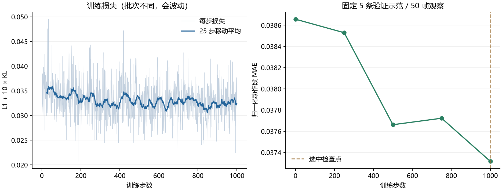
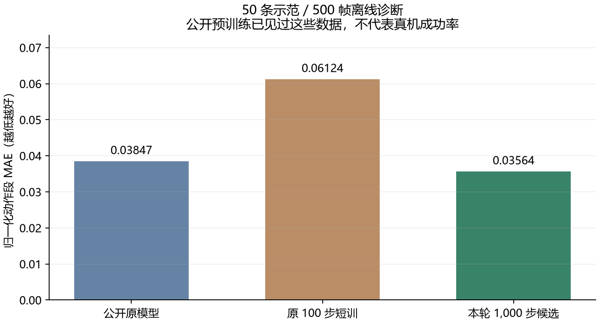
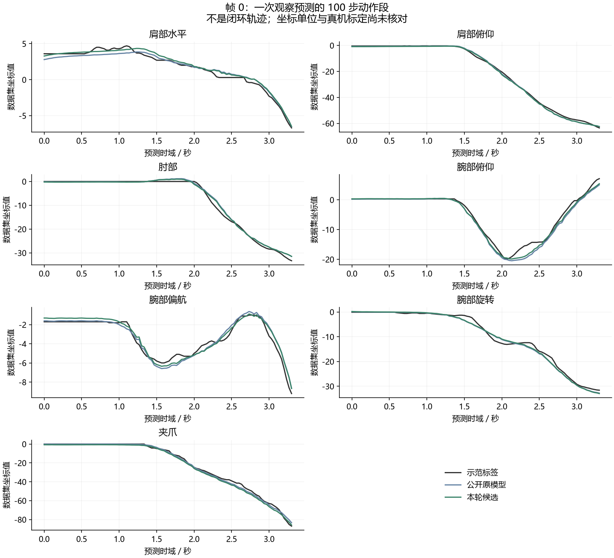

# 台式机 ACT 训练与离线评估完成报告

日期：2026-10-19。目录：`D:\外置大脑\ACT`。

本轮完成了公开数据审计、1,000 步受控继续训练、跨进程断点续训验证，以及三个模型的 500 帧离线比较。台式机当前阶段可以收尾；继续增加公开数据训练轮数，不能替代笔记本端和真实机械臂的验证。

这次是在别人已经训练好的 ACT 上继续训练，不是重新预训练通用 VLA。全程没有连接或驱动机械臂。

## CPU 限载与当前状态

用户提出限制 CPU 时，1,000 步训练已经完成。此后没有追加训练；以下配置已用于本轮最终评估和重跑数据审计，也写入台式机训练、推理、评估入口，后续运行会自动生效：

- 进程只使用逻辑核 0–3，本机共 20 个逻辑核。
- Windows 调度优先级为 `BelowNormal`。
- PyTorch 计算线程 2 个，跨算子线程 1 个；常用数值库线程限制为 2 个。
- 不启用多进程数据加载；视频解码线程也受同一进程的核心限制。

最终评估期间连续采样约 5.02 秒，ACT 进程占整机 CPU **18.17%**，核心掩码为 15，低优先级读回正确。记录见 [cpu_budget_verification.json](cpu_budget_verification.json)。这是该进程占用的一次实测，不是整机所有软件的总占用，也不是温度、功耗或长期温控保证；没有读取 CPU 温度传感器。

原 1,000 步实验发生在本次限载之前，不能把它的耗时标成限载配置下的性能。限载只作用于 ACT 进程，不修改系统电源策略或其他应用。

## 数据和训练协议

原始模型 revision：`409b639946cc4140b3934a6e3d2c255f4335ee9d`。

数据 revision：`c5cdae89d2e1f474a8e2f1ac5f16302126d0c33f`。数据共 50 条示范、20,948 帧；本次审计覆盖全部状态、动作、时间戳和 50 个示范末端的动作补齐边界，检查通过。详见 [dataset_audit.json](dataset_audit.json)。

本轮按整条示范固定划分，随机种子为 20261019：

| 用途 | 示范数 | 帧数 | 本轮使用方式 |
| --- | ---: | ---: | --- |
| 训练 | 40 | 16,870 | 更新模型；本次实际使用 4,000 个不同的起始观察帧 |
| 验证 | 5 | 2,166 | 每条取 10 帧，在步数 0、250、500、750、1,000 时比较和选择检查点 |
| 最终诊断 | 5 | 1,912 | 完成选择后再报告，不参与本轮参数更新或选择 |

验证示范编号为 `0, 30, 39, 40, 44`；最终诊断示范编号为 `13, 14, 21, 45, 48`，其余 40 条用于训练。训练批次计划已保存，执行前会拒绝含有验证或最终诊断起始帧的计划。未来 100 步动作标签只取同一条示范，末端补齐部分不计入评估误差。

**公开原模型已经见过全部 50 条示范，其归一化统计也来自原数据。这不是从预训练开始就独立留出的测试集，不能据此声称对陌生场景有泛化能力。**

本轮从公开原模型重新开始，不接着原 100 步短训模型继续训练。使用 batch 4、主干与其他参数学习率均为 `1e-6`、AdamW、float32、梯度裁剪 10；保留原模型预处理、后处理和归一化。随机批次计划固定，训练随机种子为 1000。

训练损失为 ACT 的 L1 与 10 倍 KL 项之和；验证时模型只接收图像和状态，不接收示范动作，也不使用训练时 CVAE 的动作编码。每次预测 100 步、7 维动作，评估仅计入未补齐的标签。

## 选择结果与断点续训

检查点选择指标是验证观察的归一化动作段 MAE：累积有效未来动作的绝对误差，再对动作维度和有效步数求平均。只有相对当前最佳值下降超过 `0.0001` 才替换最佳检查点。

| 训练步数 | 验证 MAE | 当时是否更新最佳 |
| ---: | ---: | --- |
| 0 | 0.03865649 | 原始基线 |
| 250 | 0.03852911 | 是 |
| 500 | 0.03766206 | 是 |
| 750 | 0.03772299 | 否 |
| 1,000 | 0.03731637 | 是 |

选中第 1,000 步，验证指标相对原模型下降约 **3.47%**。训练共保存四个完整检查点；最终选中模型已单独严格重载，并重现选择指标。训练过程中的 PyTorch 峰值活跃张量显存约 **2.20 GiB**，不含桌面、驱动等其他显存占用。

第 250 步保存模型、处理器、优化器和随机状态，先在原进程中计算一次供对照的第 251 步，再丢弃这次更新。新进程从第 250 步恢复后，第 251 步的样本顺序、损失、全部模型张量和优化器状态摘要完全一致。正式记录仍为 1,000 步，另有 1 次丢弃的诊断更新。此验证对应当时的固定软件、硬件和线程配置，不承诺跨设备或变更配置后仍逐位相同。

训练曲线：浅线是不同随机批次的损失，深线为 25 步移动平均；右侧才是用于选择模型的固定验证指标。



完整训练记录见 [controlled_training.json](controlled_training.json)、[逐步损失 CSV](controlled_training_metrics.csv)。

## 500 帧离线比较

每条示范均匀取 10 帧，共 500 帧观察；每个模型各比较 41,959 个有效未来动作步。三个模型使用相同观察、标签、归一化、有效步掩码与限载配置。输入中排除了动作标签。

| 模型 | 全部观察归一化动作段 MAE | 最终诊断 5 条示范的观察平均 MAE |
| --- | ---: | ---: |
| 公开原模型 | 0.03846958 | 0.03214420 |
| 原 100 步短训 | 0.06123750 | 0.05478882 |
| 本轮第 1,000 步候选 | **0.03563543** | **0.03053391** |

全部观察的指标按有效动作步加权；右列先计算每个观察的 MAE，再平均各观察，因此与用于检查点选择的加权指标不能直接混用。

本轮候选在全部观察上相对原模型下降约 **7.37%**，最终诊断分组的观察平均误差下降约 **5.01%**。原 100 步短训明显更差，因此不作为候选。训练子集对总指标有贡献，7.37% 不能当作独立测试提升或抓放成功率提升。



候选也并非每个指标都改善：第一个动作的原始坐标误差在肘部、腕部俯仰和腕部旋转三个通道略变差。夹爪约 9.66% 的有效预测超出数据中观察到的范围，原模型约为 21.27%；其余部分通道也有越出数据范围的预测。数据范围不等于机械臂物理限位，不能直接据此裁剪后发送真机。

下图取固定顺序中的第一帧（验证示范 0 的起点），展示一次观察所预测的动作段，属于说明样例，不是挑选成功的一次抓放，也不是闭环执行轨迹。



详细分通道误差、动作变化误差、模型哈希和范围偏差见 [desktop_final_evaluation.json](desktop_final_evaluation.json)。逐帧 CSV 与动作段样例保存在 `runs\desktop_final_evaluation\`。原始公开权重的内容哈希再次检查一致。

## 模型位置与交付边界

本轮候选推理目录：

```text
D:\外置大脑\ACT\runs\act_controlled_20261019_220629\checkpoints\step_001000\pretrained_model
```

该目录内的模型、处理器和归一化文件必须一起使用。完整续训还需要其上一级检查点中的 `training_state`，以及实验根目录中的批次计划、协议和实验状态。

候选模型 SHA-256：`94f6d02a35d4a0b41216188889ce7523366c3577f74efdfe86e926ddb1e1b4d8`。

之前交付的 `delivery\ACT_laptop_20261019_v2.zip` 保持原始公开模型，已验证的 ZIP 没有替换。新候选单独保留；现有结果不足以决定哪一个在本机真实场景抓放更好。GitHub 存代码、配置和报告；大模型、数据、完整检查点和 ZIP 保留在本地忽略目录。

## 复现入口

PowerShell 中先进入项目并加载项目环境：

```powershell
Set-Location 'D:\外置大脑\ACT'
. .\scripts\act_env.ps1
```

重跑数据审计与最终模型比较，不进行训练：

```powershell
.\.venv\Scripts\python.exe .\scripts\audit_dataset.py
.\.venv\Scripts\python.exe .\scripts\offline_evaluation.py --model 'published=D:\外置大脑\ACT\models\act_rebot_cube' --model 'short100=D:\外置大脑\ACT\runs\act_short_20261019_211728\checkpoint\pretrained_model' --model 'selected1000=D:\外置大脑\ACT\runs\act_controlled_20261019_220629\checkpoints\step_001000\pretrained_model' --report-name desktop_final_evaluation
```

仅在确实需要新实验时运行以下命令；它会创建新目录，本轮收尾没有再次执行：

```powershell
.\.venv\Scripts\python.exe .\scripts\controlled_training.py --stop-after 250 --verify-next-step
# 退出后，把下面路径替换为刚打印的新实验目录，再恢复到该实验预定的 1,000 步。
.\.venv\Scripts\python.exe .\scripts\controlled_training.py --resume 'D:\外置大脑\ACT\runs\act_controlled_<新实验时间戳>'
```

运行中的实验不要同时从另一个进程恢复同一目录。已完成实验的 `--resume` 不会自动增加目标步数；需要新增训练时另开实验。变更 CPU 线程设置后，不应将此前实验的逐位续训证明直接用于新配置。

绘图脚本为 `scripts\plot_desktop_results.py`，只读已有结果，不加载模型。训练环境无需新增 Matplotlib；本机使用 Codex 自带、已安装 Matplotlib 的 Python 运行，输出在 `reports`，缓存放 `cache\matplotlib`。

## 本机阶段验收与下一步

1. 环境、固定版本资源、公开模型离线推理：此前已通过。
2. 数据完整性与全部示范末端补齐：通过。
3. 训练、保存、严格重载和跨进程下一步续训证明：通过。
4. 三个模型各 500 帧的有限输出、比较与原始权重保护：通过。
5. CPU 限载配置和进程实际占用采样：通过。
6. 笔记本独立部署包：此前已完成，仍待笔记本实际硬件验收。

最终一致性检查记录见 [desktop_completion_checks.json](desktop_completion_checks.json)。本轮不再追加公开数据训练。下一步在笔记本核对推理环境、两路相机与关节/夹爪定义，接通真实 SDK 控制后再分阶段测试；当前只能确认模型和数据管线工作，尚未验证真实抓放效果。
