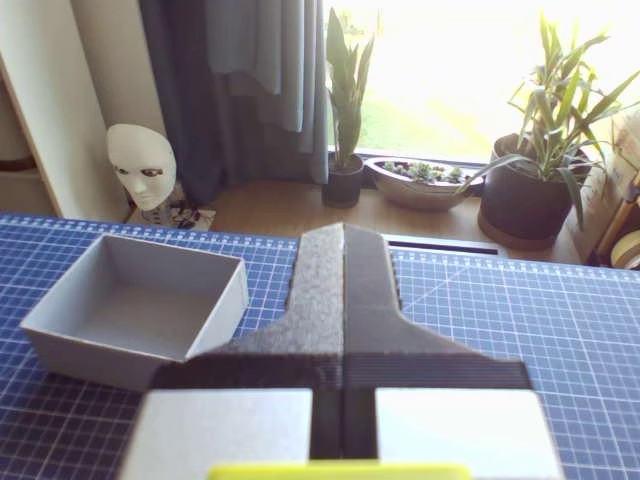
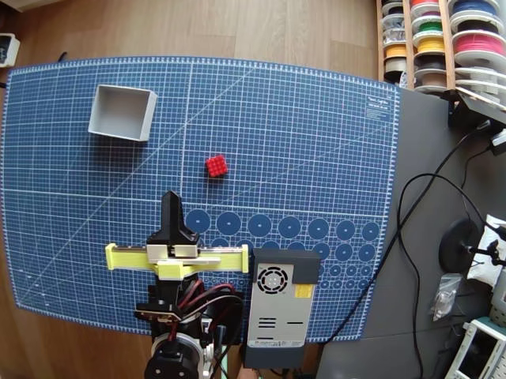

# ACT 台式机离线推理验证

日期：2026-10-19（Asia/Shanghai）

**结果：离线软件流程通过。**已完成环境安装、固定版本模型与数据下载、逐文件内容校验，以及真实双视角图像和关节状态上的 GPU 推理。本次未训练模型，未连接或驱动机械臂。

## 实际运行环境

| 项目 | 实际版本/配置 |
| --- | --- |
| GPU | NVIDIA GeForce RTX 5060 Ti 8GB |
| 系统 | Windows 11，10.0.26200 |
| Python | 3.12.15，项目内独立环境 |
| PyTorch / CUDA | 2.10.0+cu130 / 13.0 |
| torchvision | 0.25.0+cu130 |
| LeRobot | 0.6.1 |
| 视频解码 | PyAV 15.1.0，显式使用 `pyav` 后端 |
| datasets | 4.8.5 |

77 个已安装软件包依赖检查通过。`lerobot_train --help` 对应 Python 模块启动成功，退出码为 0。完整版本记录见项目根目录的 `requirements.lock.txt`。

发布者模型卡标注 LeRobot 0.6.2，本机采用当次可获取的正式版 0.6.1；严格权重加载、配套处理器和本报告的完整离线流程实际通过。未因此假定所有其他接口也已兼容。

## 固定资源与校验

- [公开模型](https://huggingface.co/nikodembartnik/act_rebot_cube)：revision `409b639946cc4140b3934a6e3d2c255f4335ee9d`。
- [公开数据集](https://huggingface.co/datasets/nikodembartnik/rebot_cube)：revision `c5cdae89d2e1f474a8e2f1ac5f16302126d0c33f`。
- 模型最终部署文件 8 个，约 197.2MiB；数据文件 11 个，约 829.0MiB。
- 大文件按上游 LFS SHA-256 校验，其他文件按 Git blob SHA-1 校验；全部通过，并额外记录本地 SHA-256。
- 完整数据共 50 条示范、20,948 帧、30 FPS。权重和配套预处理、后处理、归一化张量均已下载。
- 两个资源的许可均标注为 Apache-2.0；以下输入图像直接解码自该公开数据集。

逐文件证据见 [download_manifest.json](download_manifest.json)。

## 验证方法

1. 使用真实 CUDA 张量矩阵乘法验证 GPU 运算。
2. 从本地严格加载完整 ACT 权重；使用权重自带的视觉主干，不额外下载 ImageNet 初始化权重。
3. 从本地读取数据集，索引为 0、5236、10473、15710、20947，对应 5 个不同示范片段。
4. 解码 `wrist`、`top` 两路真实彩色图像，结合 7 维关节/夹爪状态，执行保存的预处理与归一化。
5. 模型生成未来动作段，再执行保存的反归一化与 CPU 输出处理。
6. 预热 3 次，随后每个样本测量 5 次，共 25 次。计时包含预处理、完整动作段前向、反归一化和回到 CPU，排除视频读取/解码；CUDA 计时前后同步。

运行入口设置 Hugging Face Hub 与 datasets 为离线模式，验证过程使用本地文件，不连接机械臂，也不发送动作指令。

## 测量结果

| 检查项 | 结果 |
| --- | --- |
| 权重严格加载 | 通过 |
| 5 个样本的双视角图像与状态读取 | 通过 |
| 所有预测动作均为有限数值 | 通过 |
| 每次动作输出形状 | `[1, 100, 7]` |
| 平均推理耗时 | 20.40ms |
| 中位推理耗时 | 21.69ms |
| P95 推理耗时 | 22.37ms |
| 最大推理耗时 | 22.59ms |
| PyTorch 活跃张量峰值显存 | 271.79MiB |
| PyTorch 缓存保留峰值显存 | 302.00MiB |

这里的显存是 PyTorch 记录的张量/缓存分配，不是显卡总占用。计时未包含实时相机采集、机械臂通信和控制等待，因此不能直接将 20.4ms 换算成已经验证的真机控制频率。

动作段含 100 个未来时间步，每步 7 个关节/夹爪通道；尚未设置和验证本机执行步长、动作消费方式与观察更新策略。

## 真实输入图像

以下两张图来自同一输入帧：公开数据集 episode 0、frame 0、timestamp 0.0s。它们展示发布者的安装视角，不能当作本机相机画面。

腕部视角：



俯视视角：



当前现成权重需要这两个视角。图中目标是红色方块与灰色盒子；这是本候选的任务分布，不是 ACT 对物体颜色的算法要求。

就第 0 帧这个样例而言，腕部画面没有清楚显示红色方块，俯视画面能看到方块和盒子的相对位置。两个输入在这里提供的信息并不相同。

## 结果边界与后续

- 5 个样本来自模型使用的公开训练数据，不是独立留出的泛化测试。动作与标签的误差只能辅助检查处理流程，不能作为抓取成功率。
- 抽样发现个别首步动作略超出数据中观察到的范围：frame 15710 的夹爪输出约 0.0037，frame 20947 的 shoulder_lift 输出约 0.2339。数据范围不是已确认的物理限位；真机部署还需按本机定义检查和限制动作。
- 本机机械臂零位、方向、单位、夹爪范围、相机视角和控制接口尚未验证；没有执行真机抓放。
- 笔记本的具体 CPU、GPU、显存与 Windows 驱动接口尚未确认；本报告不代表笔记本实测性能。
- 本次没有更新任何模型参数。后续可在此环境内先做小规模训练验证，或先迁移部署包到笔记本离线测速。

原始数值和每帧输出见 [offline_inference_cuda.json](offline_inference_cuda.json)。完整预测数组保存在本地 `runs/offline_inference_cuda/predicted_action_chunks.npy`，形状为 `[5, 100, 7]`。

复现命令：

```powershell
Set-Location 'D:\外置大脑\ACT'
.\scripts\run_offline.ps1
```
